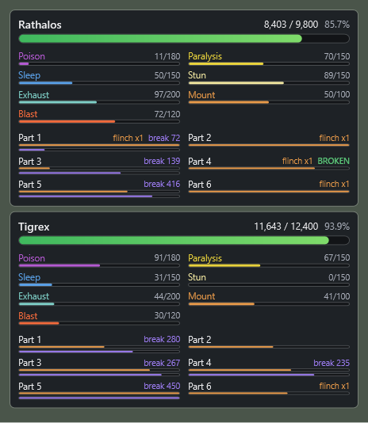
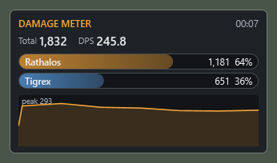
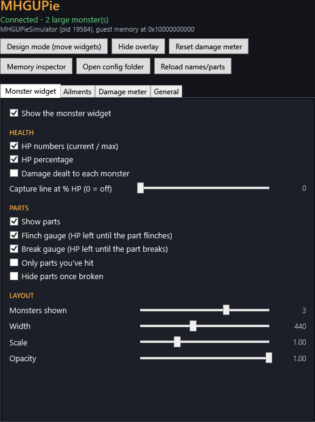
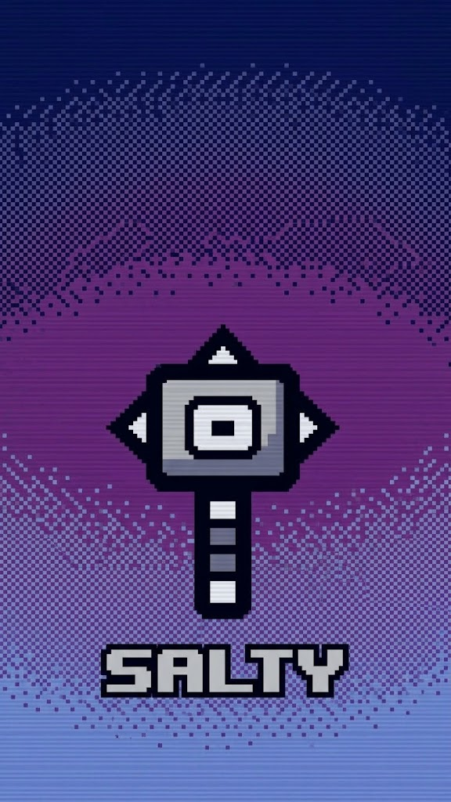

<h1 align="center">MHGUPie</h1>

<p align="center">
  <b>A HunterPie-style overlay for Monster Hunter Generations Ultimate on PC (MHGURecomp)</b><br>
  Monster HP, part flinch &amp; break gauges, ailment buildup (hits until stun / poison / sleep...) and a damage meter with DPS,
  on top of the game.
</p>

<p align="center">
  
  &nbsp;
  
</p>

---

## Contents

- [What it shows](#what-it-shows)
- [Requirements](#requirements)
- [Install (step by step)](#install-step-by-step)
- [Using it](#using-it)
- [Is my save safe?](#is-my-save-safe)
- [Troubleshooting](#troubleshooting)
- [Limitations](#limitations)
- [How it works](#how-it-works)
- [Fixing or adding offsets](#fixing-or-adding-offsets)
- [Building from source](#building-from-source)
- [Credits](#credits)

---

## What it shows

| Widget | Gauges | You can turn on/off |
|---|---|---|
| **Monster widget** | Every large monster's **HP bar**, current / max HP, % | HP numbers, %, damage dealt per monster, a capture line at a chosen % |
| | **Ailments**: Poison, Paralysis, Sleep, Stun, Exhaust, Mount, Blast. Buildup / threshold ("how many more hits until it triggers"), how many times it triggered (x2), a timer bar while it's active | each ailment separately, numbers, counts, timers, only ailments that started building up |
| | **Parts**: flinch gauge (damage left until the part flinches) + flinch count, break gauge, **BROKEN** | flinch, break, only parts you've hit, hide broken parts |
| **Damage meter** | Hunt timer, total damage, **DPS**, damage per monster with % share, DPS-over-time graph | each element separately |

Every widget can be **moved** (design mode), **scaled**, **resized**, made **see-through**, or turned off.
Each player has their own settings.

<p align="center"></p>

---

## Requirements

- **Windows 10 or 11, 64-bit.** Nothing else to install: it runs on the .NET Framework that comes with Windows.
- **Monster Hunter Generations Ultimate running in [MHGURecomp](https://github.com/morerokk/MHGURecomp)**, with game
  version **1.4.0** (the version MHGURecomp needs anyway).
- MHGURecomp in **Borderless** or **Windowed** mode (Borderless is its default). True fullscreen hides overlays.

MHGUPie contains **no game files**. You need your own working MHGURecomp setup.

---

## Install (step by step)

### 1. Download

Go to **[Releases](../../releases/latest)** and download `MHGUPie-x.y.zip`.

### 2. Unblock the zip (important)

Windows blocks programs downloaded from the internet or Discord.
**Right-click the zip → Properties → tick "Unblock" → OK**, *then* unzip it.

### 3. Unzip. You get:

```
MHGUPie\                         the overlay (MHGUPie.exe + config folder)
Play MHGU with MHGUPie.bat       starts the game and the overlay together
HOW TO INSTALL.txt               short version of this page
```

### 4. Copy two things into your MHGURecomp game folder

Copy the **`MHGUPie`** folder and **`Play MHGU with MHGUPie.bat`** into the folder that has `mhgurecomp.exe` in it:

```
Windows-MHGURecomp\
├── mhgurecomp.exe
├── mhgurecomp-updater.exe
├── data\
│   ├── exefs\
│   └── romfs\
├── MHGUPie\                      ← here
│   ├── MHGUPie.exe
│   └── config\
└── Play MHGU with MHGUPie.bat    ← and here
```

Don't replace or delete anything that's already there. You're only adding these two.

### 5. Play

Start the game with **`Play MHGU with MHGUPie.bat`** from now on. It starts the game (through the recomp's updater if
you have it) and the overlay. The overlay closes when the game closes.

You can also run `MHGUPie\MHGUPie.exe` yourself, before or after the game.

### 6. First run

- **"Windows protected your PC"**: click **More info → Run anyway**. MHGUPie isn't code-signed, so Windows doesn't
  recognise it yet.
- **Antivirus warning**: overlays (HunterPie included) read another program's memory, which some antivirus programs
  flag. Allow `MHGUPie.exe`.
- The MHGUPie window should say **Connected** once the game is running. The gauges appear when you're in a hunt.

---

## Using it

### Hotkeys (work anywhere)

| Key | Action |
|---|---|
| **Scroll Lock** | **Design mode**: widgets get an orange frame. Drag them where you want, press again to lock. Positions are saved. |
| **F9** | Hide / show the whole overlay |
| **F10** | Reset the damage meter |

To use other keys, edit `MHGUPie\settings.ini` (section `[General]`) while MHGUPie is closed.
Key names: `F8`, `Insert`, `Pause`, `Home`, ...

### The MHGUPie window

| Tab | What you can set |
|---|---|
| **Monster widget** | HP numbers, %, damage per monster, capture line, parts on/off, flinch, break, only hit parts, hide broken, how many monsters, width, scale, opacity |
| **Ailments** | ailments on/off, numbers, counts, timers, and **each ailment separately** |
| **Damage meter** | timer, total, DPS, per-monster bars, DPS graph, width, scale, opacity |
| **General** | hide the overlay when the game isn't the active window, refresh rate, start minimized |

Buttons: **Design mode**, **Hide overlay**, **Reset damage meter**, **Memory inspector**, **Open config folder**,
**Reload names/parts**.

Settings are saved in `MHGUPie\settings.ini`, or in `%APPDATA%\MHGUPie\` if the folder is read-only.

### Naming parts

MHGU stores up to 8 parts per monster **without names**, so they show as *Part 1...Part 8*. To name them, hit one
part (say the head), see which *Part N* flinch bar moved, and write it in `MHGUPie\config\parts.ini`:

```ini
[Rathalos]
Part1 = Head
Part2 = Body
Part5 = Tail
```

Then press **Reload names/parts**.

---

## Is my save safe?

**Yes.** MHGUPie:

- only **reads** the game's memory and never writes to it,
- doesn't change, add or remove any game file (it doesn't use the recomp's `mods` or `cheats` folders),
- never touches your save. MHGURecomp keeps saves in `%APPDATA%\MHGURecomp\save`, away from the game folder.

To uninstall, delete the `MHGUPie` folder and the `.bat`. (Backing up `save_0` now and then is still a good habit.)

---

## Troubleshooting

| Problem | Fix |
|---|---|
| Says *Waiting for MHGURecomp...* | Start the game. If the game runs as administrator, run MHGUPie as administrator too. |
| *Connected* but no gauges | You need to be in a hunt with a large monster. Check that the widgets are enabled and **F9** didn't hide them. |
| Gauges don't show over the game | Set MHGURecomp to **Borderless** or **Windowed**. Turn off *Hide when the game isn't the active window* to test. |
| Gauges are off-screen | Press **Scroll Lock** and drag them back, or delete `settings.ini`. |
| A monster shows as *Monster #123* | Name it in `config\names.ini` (`123 = Name`), then **Reload names/parts**. |
| Flinch/break bars look full or wrong | Start MHGUPie **before** the hunt: the bars learn their full size from the first value they see. |
| The .bat says *mhgurecomp.exe was not found* | The .bat and `MHGUPie` folder must be **next to** `mhgurecomp.exe`. |
| Something crashed | Look for `MHGUPie\MHGUPie-error.log` and open an issue with it. |

---

## Limitations

- **The damage meter counts all damage to large monsters** (yours, your palico's, poison, blast, bombs). MHGU
  doesn't record damage per hunter the way World, Rise and Wilds do. Solo it's your damage; online it's the party's.
- **Online**: as in other Monster Hunter games, ailment buildup may only be exact for the host.
- **Not shown yet**: enrage, stamina, crown size, real capture threshold (the capture line is a % you choose).

---

## How it works

MHGURecomp runs the Switch game's code natively and keeps the game's 32-bit memory in one fixed window of its own
process, at **`0x10000000000`**. A game address `g` is at `0x10000000000 + g`, so the Switch MHGU 1.4.0 layout can be
read directly. (If the window ever moves, MHGUPie looks for it.)

```
u32 [0x1A51FE0]                  monster manager
  + 0x1C + 4*i  (i = 0..9)       monster entity
    + 0x1428                     status block   (everything below is relative to it)
      + 0x1B6  u16               type id (large monsters < 10000)
      + 0x370  s32               HP
      + 0x374  s32               max HP
      + 0x3B6 + 0xC*n            part n: +6 flinch count, +7 break count, +8 flinch HP, +A break HP
      + 0x5D76 / 0x5D78          stun buildup / stun threshold
      + 0x5C9C ...               the other ailments (see the map file)
names: type id → table 0x1797EA4 → table 0x182E7F8 → line of monsterName_eng.gmd (from your game files)
```

Every 100 ms a background thread reads the monster list and the status block of each large monster. It builds the
monster / part / ailment state, works out damage from HP drops, and the widgets redraw. The overlay windows are
transparent, always on top and click-through, except in design mode.

### How sure each value is

| Data | Source | Status |
|---|---|---|
| Memory window, monster list, HP, max HP, type id, large-monster check | read out of `mhgurecomp.exe`'s own code: its HP scaling, quick-hunt and Discord features read these exact fields | **verified** |
| Monster names | the same lookup tables the recomp's Discord code uses + `monsterName_eng.gmd` | **verified** |
| Part flinch / break HP | recomp HP-scaling code, and it matches the MHXX layout exactly | **verified** |
| Stun buildup / threshold | recomp's KO (stun) tracer code | **verified** |
| Poison, paralysis, sleep, exhaust, mount, blast, part counts, timers | MHXX (3DS) monster layout, shifted to MHGU. The shift is checked on the verified stun fields, and every offset is used by the recompiled game code. | **very likely, confirm in game** |

The structure follows [HunterPie](https://github.com/HunterPie/HunterPie): a per-version **address map**, a
**scanner** that turns memory into Monster / Part / Ailment objects, and separate **overlay widgets** with their own
settings and design mode.

---

## Fixing or adding offsets

Every address lives in **`MHGUPie\config\MHGU-1.4.0.map.ini`**, so you can change one without rebuilding.
To check or find an ailment offset in game:

1. Open **Memory inspector** in MHGUPie while a large monster is around.
2. Click **Take snapshot**.
3. Hit the monster with the ailment once (e.g. a poison weapon).
4. Tick **only changed since snapshot**. The buildup value appears with its offset.
5. Put that offset in the map file under `[Ailment.Poison]` and restart MHGUPie.

If you confirm or fix an offset, open an issue or a pull request so everyone gets it.

---

## Building from source

No Visual Studio needed. The C# compiler built into Windows (.NET Framework 4.x, WPF) is enough:

```powershell
powershell -ExecutionPolicy Bypass -File build.ps1      # -> bin\MHGUPie.exe (+ bin\MHGUPieSimulator.exe)
powershell -ExecutionPolicy Bypass -File package.ps1    # -> dist\MHGUPie-<version>.zip (the release zip)
```

| Folder | What's in it |
|---|---|
| `src/Core` | `GameMemory` (attach + read the game window), `AddressMap`, `GameScanner` (poll loop), `DamageTracker`, `MonsterNames` (GMD parser + name tables), `Settings`, `Ini` |
| `src/UI` | `OverlayWindow` (click-through, topmost, design mode), `MonsterWidget`, `DamageMeterWidget`, `MainWindow` (settings), `InspectorWindow` |
| `sim/` | `MHGUPieSimulator`: fake monsters at the real addresses, for testing without the game |
| `config/` | `MHGU-1.4.0.map.ini` (all addresses), `parts.ini`, `names.ini` |
| `package/` | the `.bat` launcher and `HOW TO INSTALL.txt` that go into the release zip |

**Testing without the game:** run `bin\MHGUPieSimulator.exe --seconds 120`, then `bin\MHGUPie.exe`.
For names in this mode, set `GameDataPath` in `settings.ini` to your `monsterName_eng.gmd`.
`MHGUPie.exe --snapshot <folder> [--wait 8]` renders the widgets and settings window to PNG files and dumps what was read.

**Releasing an update:** bump `Version` in `src/App.cs`, run `package.ps1`, attach the zip to a new GitHub release.
Players replace `MHGUPie.exe` and `config\` and keep their `settings.ini`.

---

## Credits

- [HunterPie](https://github.com/HunterPie/HunterPie): the overlay this one is modelled on (Monster Hunter World / Rise / Wilds).
- [MHGURecomp](https://github.com/morerokk/MHGURecomp) by morerokk: the PC port this runs alongside.
- [MHXX Monster Info NTR Plugin](https://github.com/Setsu-BHMT/MHXX-Monster-Info-NTR-Plugin): the MHXX monster layout the ailment offsets come from.

MHGUPie is a fan-made tool and isn't affiliated with Capcom, Nintendo, HunterPie or MHGURecomp.
Monster Hunter is a trademark of Capcom. No game files are included.

---

<p align="center">
  <br>
  <sub>Made by <b>Salty</b></sub>
</p>
